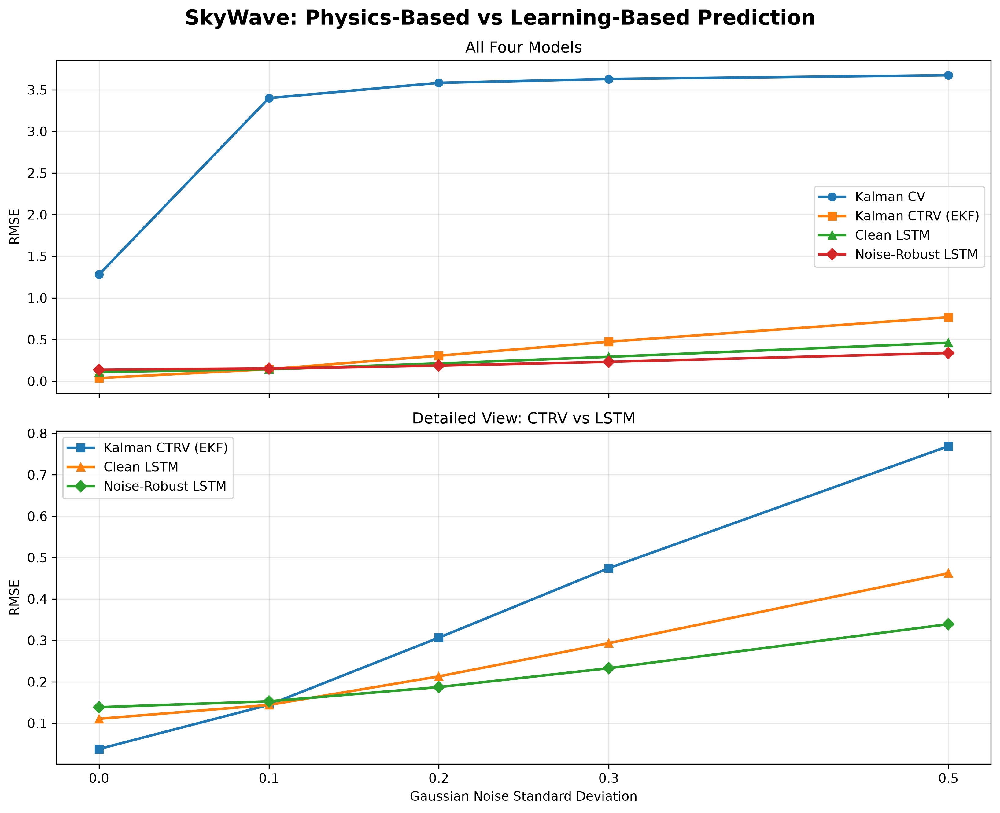

# SkyWave — Predicting the Unpredictable 🌊

### Physics-Based Trajectory Forecasting vs Deep Learning

**A Python research project exploring how mathematical motion models and neural networks respond to uncertainty.**

SkyWave compares classical state-estimation techniques with deep learning for forecasting two-dimensional trajectories. The central research question is:

**When does a physics-based model outperform a neural network, and when does learning from noisy data become an advantage?**

---

## 1. Project Overview

SkyWave investigates four forecasting configurations:

| Model | Approach | Description |
|---|---|---|
| Kalman CV | Linear Kalman Filter | Constant-velocity motion model |
| Kalman CTRV | Extended Kalman Filter | Constant-turn-rate motion model |
| Clean LSTM | Deep Learning | LSTM trained on clean circular trajectories |
| Noise-Robust LSTM | Deep Learning | LSTM trained using noisy inputs and clean prediction targets |

The project focuses on the interaction between **motion-model assumptions, measurement noise, and forecasting accuracy**.

## 2. Technology Stack

- **Python 3.12**
- **NumPy** — numerical computing and trajectory generation
- **FilterPy** — Kalman filtering
- **PyTorch** — LSTM implementation and training
- **Matplotlib** — scientific visualization
- **pytest** — automated testing

## 3. Synthetic Trajectory Generation

The project generates two-dimensional trajectories with configurable time steps and Gaussian measurement noise.

**Linear motion**

- Constant velocity along the X and Y axes
- Useful for evaluating the Constant Velocity Kalman Filter

**Circular motion**

- Configurable radius and angular speed
- Useful for investigating model mismatch and turn-rate estimation

The default time step is `0.1`.

Gaussian noise is added to the observed coordinates, while the clean trajectories are retained as ground-truth prediction targets.

## 4. Forecasting Models

### Kalman Filter — Constant Velocity

A linear Kalman Filter estimates position and velocity using the state vector:

`[x, y, vx, vy]`

This model assumes that velocity remains approximately constant. It performs well on linear motion but can accumulate substantial forecasting error when the trajectory continuously changes direction.

### Extended Kalman Filter — Constant Turn Rate

The EKF extends the state vector to:

`[x, y, vx, vy, omega]`

Here, `omega` represents angular velocity.

The nonlinear transition model accounts for turning motion, while the EKF estimates the state from noisy position measurements.

### Clean LSTM

A two-layer LSTM with 64 hidden units learns trajectory patterns from clean training data.

It receives 30 observed positions and directly predicts the next 20 positions.

### Noise-Robust LSTM

The noise-robust model uses the same LSTM architecture but is trained with noisy input observations and clean future targets.

This experiment investigates whether exposure to measurement noise during training improves robustness under noisier evaluation conditions.

## 5. Experimental Setup

The shared benchmark uses:

| Parameter | Value |
|---|---|
| Generated trajectories | 100 |
| Training / validation / test split | 70% / 15% / 15% |
| Independent test trajectories | 15 |
| Test windows | 2,265 |
| Observation window | 30 time steps |
| Prediction horizon | 20 time steps |
| Time step | 0.1 |
| Gaussian noise levels | 0.0, 0.1, 0.2, 0.3, 0.5 |
| Evaluation metrics | MAE, RMSE |

All four configurations are evaluated on identical noisy observation windows and identical clean future targets.

The 2,265 test windows overlap and should not be interpreted as 2,265 statistically independent samples.

## 6. Benchmark Results

### RMSE Across Noise Levels

Lower RMSE indicates better forecasting accuracy.

| Noise σ | Kalman CV | Kalman CTRV | Clean LSTM | Noise-Robust LSTM |
|---|---:|---:|---:|---:|
| 0.0 | 1.2810 | **0.0376** | 0.1106 | 0.1385 |
| 0.1 | 3.3997 | 0.1443 | **0.1440** | 0.1528 |
| 0.2 | 3.5828 | 0.3065 | 0.2130 | **0.1871** |
| 0.3 | 3.6289 | 0.4744 | 0.2932 | **0.2327** |
| 0.5 | 3.6740 | 0.7691 | 0.4622 | **0.3392** |

### Visualization



The upper panel presents all four configurations, while the lower panel provides a detailed comparison of the turn-rate EKF and both LSTM models.

## 7. Stability Across Random Noise Seeds

The benchmark was repeated using three noise seeds: `42`, `123`, and `2026`.

The test trajectories and trained model weights remained fixed.

| Noise σ | Model | Mean RMSE | Std RMSE |
|---|---|---:|---:|
| 0.1 | Kalman CV | 3.4006 | 0.0013 |
| 0.1 | Kalman CTRV | 0.1461 | 0.0047 |
| 0.1 | Clean LSTM | **0.1432** | 0.0009 |
| 0.1 | Noise-Robust LSTM | 0.1520 | 0.0009 |
| 0.5 | Kalman CV | 3.6790 | 0.0074 |
| 0.5 | Kalman CTRV | 0.7736 | 0.0151 |
| 0.5 | Clean LSTM | 0.4646 | 0.0022 |
| 0.5 | Noise-Robust LSTM | **0.3393** | 0.0044 |

These repetitions assess sensitivity to different realizations of measurement noise, not uncertainty across independently sampled test datasets.

## 8. Key Findings

**Finding 1 — Motion-model selection matters.**

The Constant Velocity Kalman Filter struggles with circular trajectories because its motion assumptions do not capture continuous turning.

Introducing a Constant Turn Rate model substantially reduces prediction error.

**Finding 2 — Physics-based forecasting can be highly accurate in clean conditions.**

At zero measurement noise, the turn-rate EKF achieves the lowest RMSE among the evaluated configurations.

**Finding 3 — Learning-based robustness becomes valuable as noise increases.**

At higher noise levels, the Noise-Robust LSTM achieves lower prediction error than the evaluated Kalman configurations and the Clean LSTM.

**Finding 4 — No single configuration dominates every condition.**

The best-performing approach depends on motion assumptions, measurement quality, and training conditions.

## 9. Reproducing the Experiments

Install the project dependencies in a Python virtual environment.

Run the shared four-model benchmark:

```bash
python -m src.evaluation.compare_models
```

Compare performance across Gaussian noise levels:

```bash
python -m src.evaluation.compare_noise_levels
```

Evaluate sensitivity to random noise seeds:

```bash
python -m src.evaluation.evaluate_seed_stability
```

Generate the comparison visualization:

```bash
python -m src.visualization.plot_four_model_comparison
```

## 10. Research Limitations

- The experiments use synthetic trajectories rather than real tracking data.
- The main comparison focuses on circular motion.
- The test set contains 15 independent trajectories, with overlapping evaluation windows.
- The noise-seed study uses only three random seeds.
- Kalman models receive the assumed measurement-noise standard deviation as a configuration parameter, while LSTM models receive only observed coordinates.
- The reported results do not establish universal superiority or statistical significance across broader trajectory distributions.
- Additional evaluation is needed for more complex motion, independent test datasets, parameter sensitivity, and computational cost.

## 11. Future Research

Potential extensions include irregular trajectories, changing angular velocity, additional noise distributions, trajectory-level uncertainty analysis, and real-world tracking datasets.

## Conclusion

**SkyWave demonstrates that forecasting accuracy is not determined by algorithmic complexity alone.**

A well-matched mathematical model can be exceptionally effective when its assumptions reflect the underlying dynamics. A neural network trained with noisy observations can offer advantages when measurement uncertainty increases.

The most useful question is not simply *Kalman Filter or LSTM?*

It is:

**Which assumptions, training conditions, and uncertainty levels make each approach effective?**

---

*SkyWave — Predicting the Unpredictable.*

*Research and implementation by Yuliia Okhrymenko.*

